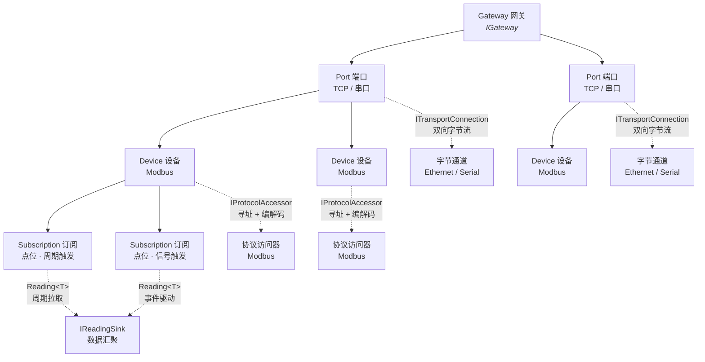
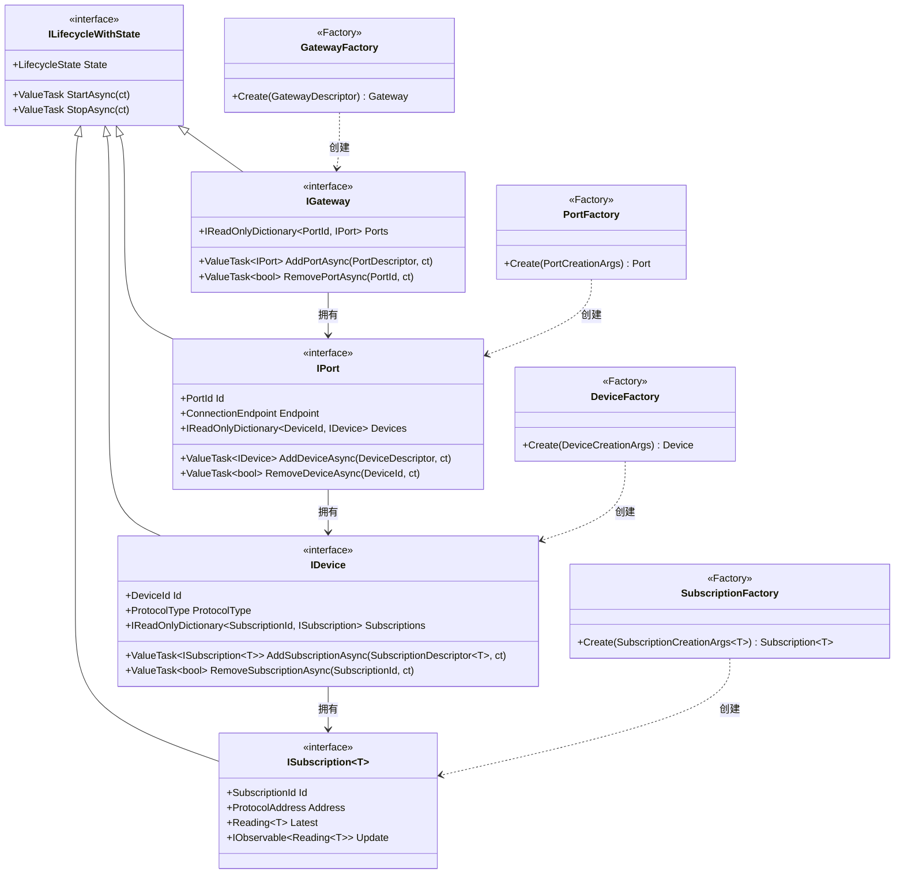
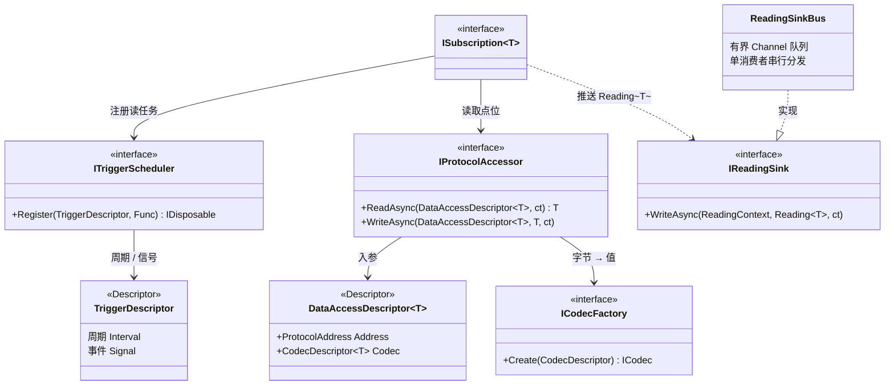
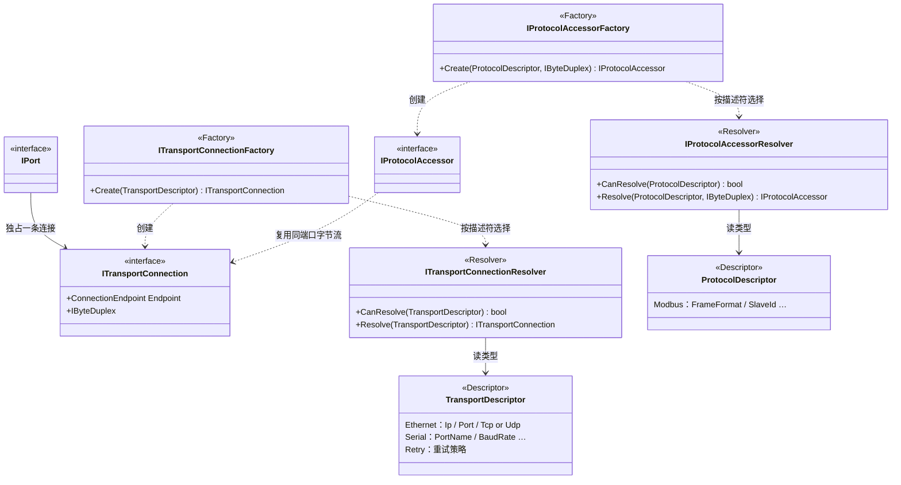
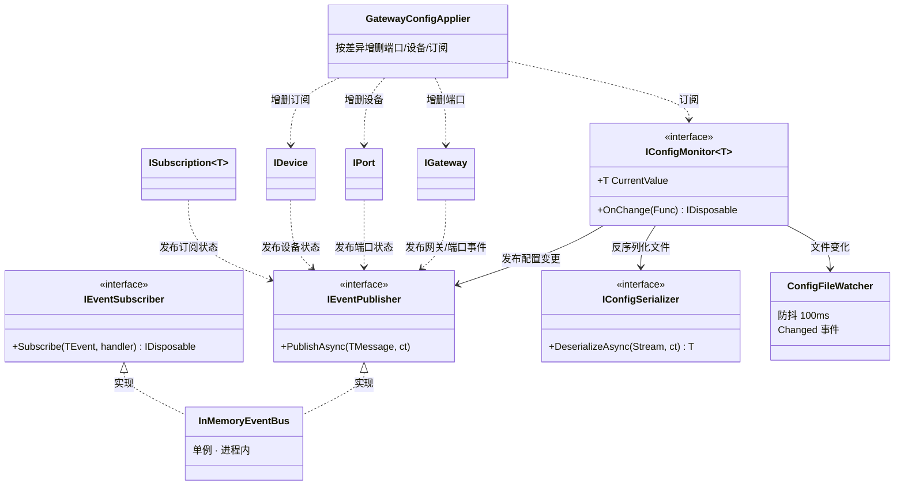
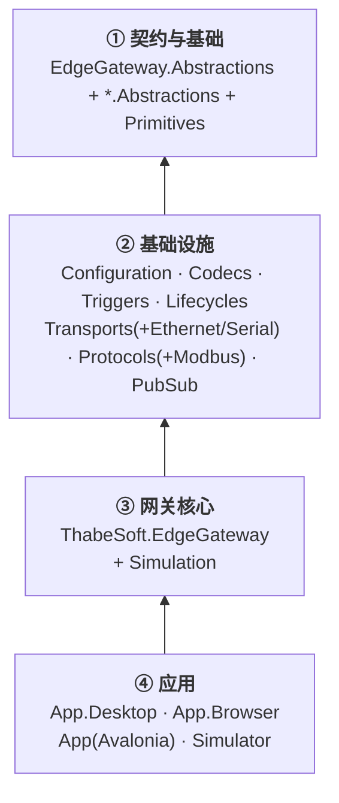
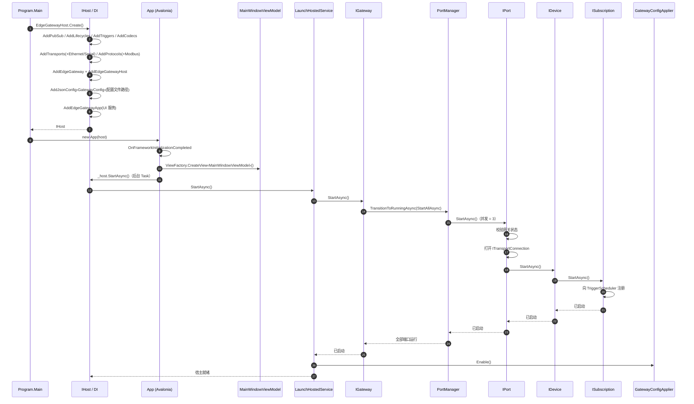
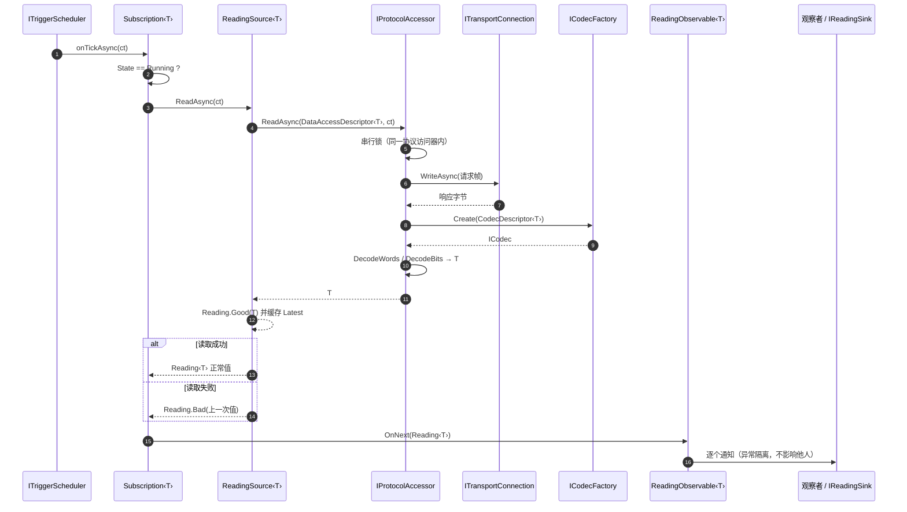
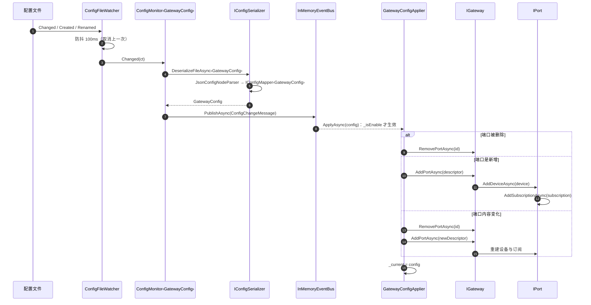
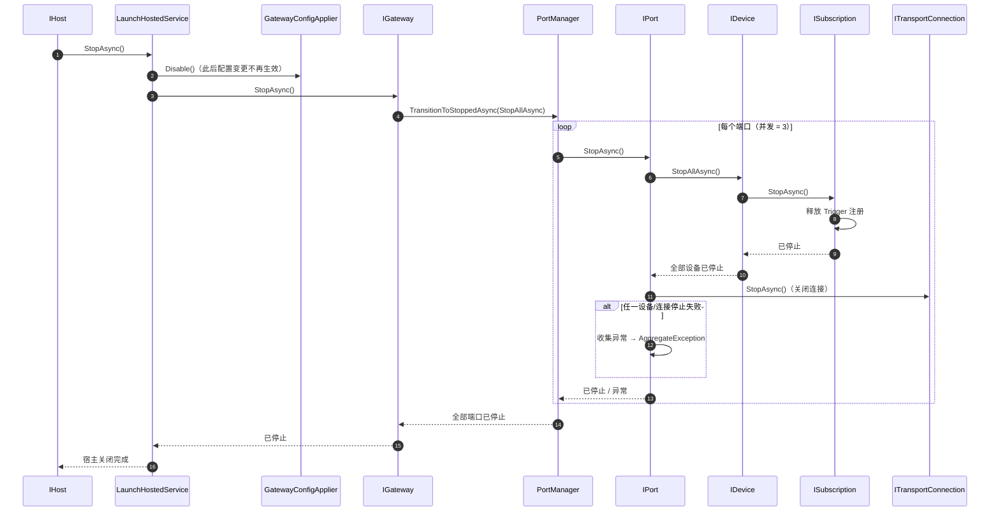

# EdgeGateway (边缘网关)

> 解决 plc 数据点位多、连接方式复杂的问题：一个进程把 **多条物理连接 · 多种 PLC 协议 · 成百上千个点位** 收拢成统一的强类型数据流。

---

## 目录

- [一、设计理念](#一设计理念)
- [二、接口分层与依赖关系](#二接口分层与依赖关系)
- [三、程序集分层](#三程序集分层)
- [四、时序图](#四时序图)
- [五、扩展点速查](#五扩展点速查)
- [六、致谢](#六致谢)

---

## 一、设计理念

系统按 **连接 → 设备 → 点位** 三层拆解，每层只依赖下一层的抽象：

| 层 | 职责 | 扩展新东西时 | 改动范围 |
| --- | --- | --- | --- |
| **Port（连接）** | 维护一条物理字节通道的启停、重连、并发 | 新增一路连接 | 只改配置文件 |
| **Device（设备）** | 在该通道上按某协议寻址、编解码 | 新增一种 PLC 协议 | 加一个 `IProtocolAccessor` 实现 |
| **Subscription（点位）** | 按触发器周期/事件驱动读取一个点位 | 新增一批点位 | 只改配置文件 |

三层之间只通过 **描述符（Descriptor）与工厂（Factory）** 结合，没有交叉引用：
连接不知道上面跑什么协议，设备不知道点位有多少个，订阅不知道字节从哪来。

---

## 二、接口分层与依赖关系

> 规律：**每个接口配一个 `*Descriptor`**（承载超时、地址、编码等数据），
> **每个接口配一个 `*Factory`**（负责装配），**生命周期统一由状态机包装**。

### 2.1 核心三层

### 2.2 订阅读取链路

订阅本身**不含协议逻辑**：它只负责「什么时候读」，
真正读什么、怎么解码，全交给 `ITriggerScheduler` 与 `IProtocolAccessor`。

### 2.3 传输与协议解耦

传输层**只搬字节，不懂协议**；协议层**只管寻址与编解码，不碰 socket**。
两者由 `PortFactory` 用同一个 `IByteDuplex` 串联，一个端口上所有设备复用同一条连接。

### 2.4 事件总线与配置

网关核心与 UI **不认识彼此**：状态变更只发事件，配置只走监视器。
新增一种 PLC 协议时，UI 无需任何改动。

---

## 三、程序集分层

4 层，**箭头只指向下一层**，跨层引用一概不允许：

两条最容易踩的规矩：

- **应用层是唯一组合根**：只有 `App.Desktop` 的 `EdgeGatewayHost` 同时引用所有实现；UI 项目 `App` 只引用 `EdgeGateway.Abstractions`。
- **契约与实现分开**：上层永远依赖 `*.Abstractions`，不依赖具体实现，所以换协议/换传输不需要动核心。

| 层 | 程序集 |
| --- | --- |
| ④ 应用 | `App.Desktop`（组合根，PublishAot）、`App.Browser`、`App`（Avalonia UI）、`Simulator` |
| ③ 网关核心 | `ThabeSoft.EdgeGateway`、`EdgeGateway.Abstractions`*、`EdgeGateway.Simulation` |
| ② 基础设施 | `Configuration` / `Codecs` / `Triggers` / `Lifecycles` / `Transports`(+`.Ethernet` `.Serial`) / `Protocols`(+`.Modbus`) / `PubSub` |
| ① 契约与基础 | `Primitives`、`Configuration.Abstractions`、`Codecs.Abstractions`、`Triggers.Abstractions`、`Lifecycles.Abstractions` |

\* `EdgeGateway.Abstractions` 也属于契约层，只是被应用层直接引用，故与网关核心同列。

---

## 四、时序图

### 4.1 应用启动

`Program.Main` → 建容器 → Avalonia 启动 → 宿主后台启动；
UI 线程**不等待**网关启动，网关内部逐层 `Start` 后再挂上配置监听。

### 4.2 定时采集一次数据

一个触发器 tick 走完「协议读 → 编解码 → 强类型值 → 推给观察者」全流程；
读数失败不抛异常，而是产出 `Quality = Bad` 的 `Reading`，保持点位不断流。

### 4.3 配置文件热更新

文件变化 → 防抖 → 反序列化 → 发事件 → 差异对比 → **只重建变化的端口**；
端口级增删改由引用相等判断，未变化的端口不会被重启。

### 4.4 优雅停机

`Stop` 自底向上反序：**先停订阅、再停设备、最后关连接**，与 `Start` 完全对称；
每个端口独立收集异常，单个端口失败不影响其余端口停止。

---

## 五、扩展点速查

| 想做什么 | 需要新增 | 需要修改 |
| --- | --- | --- |
| 新增一个点位 | 无（只改 JSON） | 配置文件 |
| 新增一路连接 | 无（只改 JSON） | 配置文件 |
| 新增一种 PLC 协议 | `IProtocolAccessor` + `IProtocolAccessorResolver` + `ProtocolDescriptor` + `ProtocolAddress` | 注册 `AddModbusProtocol()` 同款 DI 扩展 |
| 新增一种物理传输 | `ITransportConnection` + `ITransportConnectionResolver` + `TransportDescriptor` | 同上 |
| 新增一种编解码格式 | `ICodec` 实现 | 注册到 `ICodecFactory` |
| 新增一种触发方式 | `TriggerDescriptor` + `ITrigger` | 注册到 `ITriggerScheduler` |
| 接收全部数据 | `IReadingSink` 实现 | 注册到 DI（可能多个） |
| 前端展示新状态 | 订阅 `IEventSubscriber` | 无 |

---

## 六、致谢

本项目站在这些开源项目的肩膀上，感谢它们的作者与维护者。
（版本号以 `Directory.Packages.props` 中的中央版本管理为准）

### 协议与通信

| 库 | 版本 | 用途 |
| --- | --- | --- |
| [NModbus](https://github.com/NModbus/NModbus) | 3.0.83 | Modbus 主站/从站实现，`Protocols.Modbus` 的请求帧与 `Simulator` 的从站基础 |
| [RJCP.SerialPortStream](https://github.com/jcurl/SerialPortStream) | 3.0.5 | 跨平台串口（`System.IO.Ports` 在 Linux/macOS 支持有限） |

### 运行时与基础库

| 库 | 版本 | 用途 |
| --- | --- | --- |
| [System.Reactive](https://github.com/dotnet/reactive) | 7.0.0 | `IObservable<T>` 推流，点位订阅读数下发 |
| [System.Threading.Channels](https://learn.microsoft.com/dotnet/standard/parallel-programming) | 10.0.14 | `ReadingSinkBus` 的有界队列，单消费者串行分发 |
| [System.Text.Json](https://learn.microsoft.com/dotnet/api/system.text.json) | 11.0.0 | 配置文件解析 |
| [System.Collections.Immutable](https://learn.microsoft.com/dotnet/api/system.collections.immutable) | 11.0.0 | 不可变配置模型（`ImmutableArray<T>`） |
| [System.IO.Ports](https://learn.microsoft.com/dotnet/api/system.io.ports) | 10.0.14 | 串口类型与枚举定义 |
| [System.Threading.Tasks.Extensions](https://www.nuget.org/packages/System.Threading.Tasks.Extensions) | 4.6.3 | `ValueTask` 在 netstandard2.0 目标上的支撑 |
| [PolyShim](https://github.com/ChrML/PolyShim) | 2.16.0 | 为 netstandard2.0 目标补齐新语法与 BCL API |
| [Microsoft.Bcl.TimeProvider](https://www.nuget.org/packages/Microsoft.Bcl.TimeProvider) | 11.0.0 | `TimeProvider` 抽象，让触发器可在测试中注入虚拟时间 |

### Microsoft.Extensions 托管与依赖注入

`Microsoft.Extensions.Hosting` 10.0.14 · `Microsoft.Extensions.DependencyInjection` 11.0.0 ·
`Microsoft.Extensions.Logging` 11.0.0 · `Microsoft.Extensions.Options` 10.0.14
及其 `*.Abstractions` 包 —— 承担宿主生命周期、DI 容器、日志与配置绑定，
整个网关的启动/停止顺序都由 `IHostedService` 编排。

### 模拟器

| 库 | 版本 | 用途 |
| --- | --- | --- |
| [Microsoft.CodeAnalysis.CSharp.Scripting](https://github.com/dotnet/roslyn) | 5.9.0 | Simulator 中动态脚本化模拟点位数值 |

### 桌面 UI

| 库 | 版本 | 用途 |
| --- | --- | --- |
| [Avalonia](https://github.com/AvaloniaUI/Avalonia) | 12.1.4 | 跨平台 XAML UI 框架（含 Desktop / Browser 后端） |
| [SukiUI](https://github.com/kikipoulet/SukiUI) | 7.0.1 | 窗口、侧边菜单、对话框与 Toast 组件；`SukiUI.Dock` 提供停靠样式 |
| [ReactiveUI.Avalonia](https://github.com/reactiveui/ReactiveUI) | 12.1.6 | MVVM 响应式绑定与 UI 线程调度器 |
| [CommunityToolkit.Mvvm](https://github.com/CommunityToolkit/dotnet) | 8.4.2 | `ObservableObject`、`RelayCommand` 与源生成器 |
| [ScottPlot.Avalonia](https://github.com/ScottPlot/ScottPlot) | 5.1.59 | 点位历史曲线图表 |
| [Material.Icons](https://github.com/SKProCH/Material.Icons) | 3.0.2 | 图标控件与图标集 |

### 测试

| 库 | 版本 | 用途 |
| --- | --- | --- |
| [MSTest.Sdk](https://github.com/microsoft/testfx) | 4.5.2 | 单元/集成测试框架（Microsoft.Testing.Platform） |
| [Moq](https://github.com/devlooped/moq) | 4.21.0 | 接口打桩与行为验证 |
| [Microsoft.Extensions.TimeProvider.Testing](https://github.com/dotnet/extensions) | 10.11.0 | 虚拟时间，驱动触发器与超时逻辑的确定性测试 |

